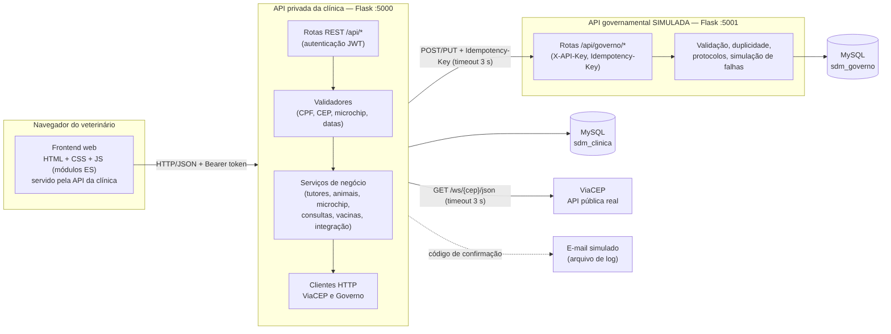
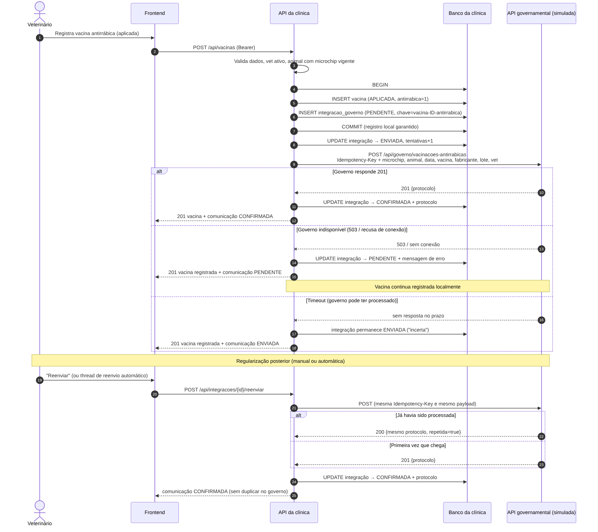
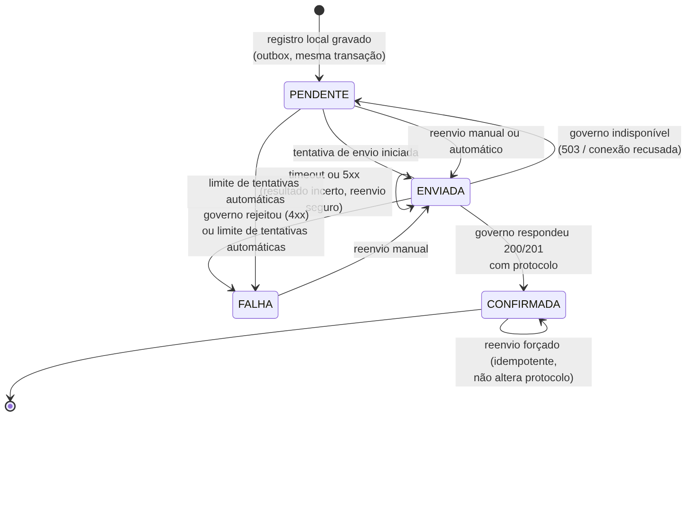

# 01 — Requisitos e arquitetura

Projeto A3 – SDM · Sistema Web para Gestão de Clínica Veterinária com Integração de APIs
Apresentação/entrega: **26/11/2026**

> **Entregável 1** do enunciado: documento de requisitos e descrição da arquitetura.
> Os demais entregáveis estão em: [02 – Modelo de dados](02-modelo-de-dados.md) ·
> [03 – Endpoints](03-endpoints.md) · [04 – Relatório de testes](04-relatorio-de-testes.md) ·
> [05 – Roteiro de apresentação](05-roteiro-de-apresentacao.md) · [README](../README.md) (instalação e execução).

---

## 1. Visão geral

Uma clínica veterinária precisa gerenciar **tutores, animais, veterinários, consultas e vacinas**. O
sistema entregue é composto por **três componentes que conversam por HTTP**:

| Componente | O que é | Porta | Persistência |
|---|---|---|---|
| **Frontend web** | Interface responsiva (HTML + CSS + JavaScript puro, módulos ES) | servido em `:5000` | — |
| **API privada da clínica** | API REST em Flask com as regras de negócio, autenticação e persistência | `5000` | MySQL `sdm_clinica` |
| **API governamental simulada** | Serviço **fictício e independente** de registro de animais por microchip e de vacinações antirrábicas | `5001` | MySQL `sdm_governo` (banco próprio) |

Além disso, a API da clínica **consome a API pública real ViaCEP** para preencher endereços.

> A API governamental é uma simulação acadêmica. **Não** é, e não se apresenta como, integração
> oficial com sistemas governamentais reais.

Regra de negócio central (enunciado, seção 4): **toda aplicação de vacina antirrábica é comunicada
obrigatoriamente ao governo**, após o registro local; se o governo estiver fora do ar, a vacina
permanece registrada, a comunicação fica **pendente** e é regularizada depois, **sem duplicar** o
registro no serviço externo.

---

## 2. Arquitetura

Fonte editável: [`diagramas/arquitetura.mmd`](diagramas/arquitetura.mmd).

### 2.1 Camadas da API da clínica

| Camada | Pasta/arquivo | Responsabilidade |
|---|---|---|
| Rotas (HTTP) | `clinica_api/routes/` | Receber a requisição, exigir autenticação (`@login_required`), chamar o serviço e serializar a resposta/erro |
| Validação | `clinica_api/validators.py` | CPF, CEP, microchip (15 dígitos), datas, e-mail, telefone, domínios |
| Serviços (regras de negócio) | `clinica_api/services/` | Tutores, animais, microchip, consultas, vacinas, catálogos, veterinários, **integração** |
| Clientes externos | `services/viacep.py`, `services/governo_client.py` | Chamadas HTTP com *timeout* e classificação do resultado (OK / INDISPONÍVEL / INCERTO / REJEITADO) |
| Acesso a dados | `clinica_api/db.py`, `database/ddl.py` | Conexão por requisição, SQL parametrizado, DDL único para MySQL |
| Erros | `clinica_api/errors.py` | Formato único `{"erro": {"codigo", "mensagem", "detalhes"}}` |

A API governamental (`governo_api/`) segue a mesma ideia, em um único módulo mais enxuto, com
banco **separado**.

### 2.2 Frontend

JavaScript puro organizado em módulos (`frontend/js/`): `api.js` (cliente HTTP + tratamento de
401/erros), `ui.js` (modais, toasts, máscaras, `badge`), `validacao.js` (validação no navegador:
CPF, CEP, microchip…), `main.js` (roteador por *hash*) e `views/*` (uma tela por arquivo). O token
fica em `sessionStorage` (some ao fechar a aba). O frontend **nunca** fala com o governo
diretamente: toda comunicação passa pela API da clínica.

### 2.3 Justificativa das tecnologias

| Escolha | Motivo |
|---|---|
| **Python + Flask** | Pequeno e explícito: cada camada fica visível no código, bom para explicar na apresentação; ecossistema pronto para JWT, hash de senha e testes |
| **MySQL 8** | Banco relacional pedido no enunciado; suporta `CHECK` (≥ 8.0.16) e chaves compostas usadas na modelagem |
| **HTML + CSS + JS puro** | Sem *build* nem dependências de frontend; a equipe consegue explicar cada linha; responsivo com CSS próprio |
| **JWT + sessão revogável** | Token sem estado para o frontend, mas com tabela `sessao_login` para logout real e derrubada imediata de veterinário inativado |
| **Werkzeug scrypt** | Hash de senha com *salt* aleatório e custo configurado pela biblioteca (não é hash simples) |
| **OpenAPI/Swagger** | Exigido; o YAML é a fonte única da documentação ([03](03-endpoints.md)) e é validado contra as rotas reais por teste automatizado |
| **pytest + Postman (+ Playwright)** | Testes de unidade/integração, coleção de API exigida pelo enunciado e um teste de interface ponta a ponta |
| **SQLite (somente dev/testes)** | Permite rodar a suíte automatizada sem servidor MySQL; o DDL é o mesmo |

---

## 3. Requisitos funcionais

Legenda de rastreabilidade: **T01–T16** = testes obrigatórios (enunciado, seção 9).

| ID | Requisito | Seção do enunciado | Testes |
|---|---|---|---|
| RF01 | **Login** por e-mail e senha; acesso só para veterinário cadastrado, **ativo** e com **senha confirmada** | 3.1 | T01–T04 |
| RF02 | Senha armazenada com **hash**; **confirmação por código** (e-mail simulado) com validade e limite de tentativas | 3.1, 3.6 | T03, T04 |
| RF03 | **Logout** encerrando a sessão; endpoints privados recusam acesso sem token válido | 3.1 | T01 |
| RF04 | CRUD lógico de **tutores**; **CPF validado e único** | 3.2 | T05 |
| RF05 | **Endereços** com preenchimento automático por **ViaCEP**; complemento manual; tratamento de CEP inexistente, *timeout* e indisponibilidade | 3.3 | T06 |
| RF06 | Catálogo de **espécies** | 3.4 | T07 |
| RF07 | Catálogo de **raças** por espécie; raça **compatível** com a espécie; opção **sem raça** | 3.5 | T07 |
| RF08 | CRUD lógico de **veterinários** (CRMV, situação, último acesso) | 3.6 | T01–T03 |
| RF09 | Cadastro/alteração de **animais** (tutor obrigatório, espécie, raça opcional, sexo, cor, peso, idade ou nascimento) | 3.7 | T07 |
| RF10 | **Vínculo de microchip** por veterinário autenticado e ativo; chip **único**; registro de responsável e data; **substituição preserva o histórico** | 3.7 | T07, T08 |
| RF11 | Consulta do animal com a **situação de sua integração governamental** | 3.7 (6) | T07, T11 |
| RF12 | **Consultas** (anamnese, sintomas, diagnóstico, tratamento, prescrição, peso, temperatura, situação) e **histórico** por animal | 3.8 | T09 |
| RF13 | **Vacinas** (lote, fabricante, dose, via, validade, próxima dose, situação), **histórico** e **próximas doses** | 3.9 | T10 |
| RF14 | Vacina antirrábica identificada por **classificação estruturada** (`tipo_vacina = ANTIRRABICA`), não pelo nome digitado | 3.9 | T12 |
| RF15 | **API privada REST** com criação, consulta, atualização e exclusão lógica | 3.10 | T01–T16 |
| RF16 | **API governamental simulada**: cadastrar, consultar por microchip, atualizar, receber vacinação antirrábica, validar, impedir duplicidade, gerar protocolo, simular erros e indisponibilidade | 3.11 | T11–T16 |
| RF17 | **Comunicação obrigatória** da vacina antirrábica aplicada (regras RN-AR1 a RN-AR8, abaixo) | 4 | T12–T16 |
| RF18 | **Controle das integrações** (situação, protocolo, chave de idempotência, tentativas, erro) e telas para acompanhar e reenviar | 5 | T14–T16 |

### 3.1 Regras de negócio da comunicação antirrábica (enunciado, seção 4)

| ID | Regra | Como é atendida |
|---|---|---|
| RN-AR1 | Vacina antirrábica **aplicada** gera solicitação de comunicação | `vacinas.registrar/aplicar` cria a linha em `integracao_governo` na mesma transação |
| RN-AR2 | Obrigatória mesmo que o animal **não esteja cadastrado** no governo | O envio da vacinação não depende do cadastro prévio; o governo registra a vacinação por microchip |
| RN-AR3 | Registrar **resultado e protocolo** | Colunas `situacao`, `protocolo_externo`, `respondida_em`, `mensagem_erro` |
| RN-AR4 | Governo indisponível → vacina fica registrada, comunicação **PENDENTE** | Registro local confirmado (*commit*) **antes** da chamada de rede |
| RN-AR5 | **Novas tentativas** automáticas ou manuais | Thread de reenvio (`AUTO_RETRY`) e `POST /api/integracoes/{id}/reenviar`, `/reprocessar-pendentes` |
| RN-AR6 | Repetição **sem duplicidade** no serviço externo | `Idempotency-Key` fixa por vacina (`vacina-{id}-antirrabica`) + `UNIQUE (microchip, id_aplicacao_origem)` e `UNIQUE (microchip, data_aplicacao, numero_lote)` no governo |
| RN-AR7 | Não antirrábicas **não** são comunicadas | `comunicacao_governo.obrigatoria = false`; nenhuma linha de integração é criada |
| RN-AR8 | **Consultar o estado** da comunicação | `GET /api/vacinas/{id}/comunicacao-governo`, histórico de vacinas e tela "Integrações" |

A aplicação distingue **registro local** de **confirmação do governo**: a resposta de `POST /api/vacinas`
traz a vacina (já gravada) e, separadamente, o objeto `comunicacao_governo` com a situação atual.

### 3.2 Regras de negócio do microchip (enunciado, seção 3.7)

| ID | Regra | Como é atendida |
|---|---|---|
| RN-MC1 | Todo animal tem tutor | `tutor_id NOT NULL` + FK |
| RN-MC2 | Identificador do microchip **único** | `UNIQUE (codigo_microchip)`; API devolve `409 MICROCHIP_JA_UTILIZADO` |
| RN-MC3 | Vínculo feito por veterinário **autenticado, ativo e autorizado** | O responsável vem do token; `@login_required` revalida situação ATIVO e senha confirmada a cada requisição |
| RN-MC4 | Registrar profissional e data | `veterinario_id`, `data_vinculo` |
| RN-MC5 | Substituição **preserva o histórico** | Vínculo anterior vira `SUBSTITUIDO` (com motivo e data); `UNIQUE (animal_id, vigente)` garante um único ativo |
| RN-MC6 | Consultar o animal e a situação da integração | `GET /api/animais/{id}` e `GET /api/animais/{id}/integracao-governo` |

---

## 4. Requisitos não funcionais

| ID | Requisito (enunciado, seção 7) | Atendimento |
|---|---|---|
| RNF01 | Interface web **responsiva** | CSS com *breakpoints*; captura de tela móvel em `docs/img/ui/14-movel-vacinas.png` |
| RNF02 | Frontend ↔ backend por **API REST** | `fetch` + JSON; nenhuma regra de negócio depende de renderização no servidor |
| RNF03 | Banco **relacional** | MySQL, 12 tabelas na clínica e 3 no governo ([02](02-modelo-de-dados.md)) |
| RNF04 | Validação no **frontend e no backend** | `frontend/js/validacao.js` (feedback imediato) e `clinica_api/validators.py` (autoridade final) |
| RNF05 | Tratamento de **erros HTTP, timeout e indisponibilidade** | Seção 6 abaixo |
| RNF06 | **Autenticação e autorização** nos endpoints protegidos | JWT + revalidação do veterinário a cada requisição; API-key no governo |
| RNF07 | **Credenciais seguras** | Senha com scrypt; código de confirmação só como HMAC; segredo e chaves via variáveis de ambiente |
| RNF08 | **Registro das operações** de integração | Tabela `integracao_governo` (+ `payload_enviado`) e `gov_operacao` no governo |
| RNF09 | **Documentação** dos endpoints | OpenAPI/Swagger ([03](03-endpoints.md)) |
| RNF10 | Código em **componentes e camadas** | Seção 2.1 |
| RNF11 | **Dados fictícios** | `database/seed.py` e `database/mysql/02_clinica_seed.sql` (CPFs de teste, microchips simulados) |

### 4.1 Segurança — resumo das decisões

* **Senha**: nunca em texto puro; hash scrypt com *salt* aleatório.
* **Login sem enumeração de usuários**: e-mail inexistente e senha errada devolvem o **mesmo** `401` genérico
  (com gasto de tempo de hash equivalente). Só **depois de a senha estar correta** o sistema informa que a
  conta está inativa (`403`) ou com senha não confirmada (`403`).
* **Confirmação por código**: 6 dígitos gerados com `secrets`, guardados como HMAC-SHA256, com **validade**
  (`CODIGO_TTL_MIN`), **uso único** e **limite de tentativas** (`CODIGO_MAX_TENTATIVAS`, depois `429`).
  O e-mail é simulado: o conteúdo vai para `data/emails_simulados.log` e, **somente em ambiente `dev`**, o
  código também é devolvido na resposta (`codigo_simulado`) para facilitar a demonstração.
* **Sessão**: JWT HS256 com `jti` registrado em `sessao_login`. Logout revoga o `jti`; inativar o veterinário
  derruba o acesso **imediatamente**, pois cada requisição revalida a situação no banco.
* **SQL parametrizado** em toda a camada de dados (sem concatenar entrada do usuário).
* **API do governo** exige `X-API-Key` (padrão de demonstração `chave-demo-governo`, configurável).
* **CORS** desligado por padrão (o frontend é servido pela mesma origem).

---

## 5. Fluxo da comunicação obrigatória de vacina antirrábica

Fonte editável: [`diagramas/sequencia-antirrabica.mmd`](diagramas/sequencia-antirrabica.mmd).

Pontos de projeto que sustentam as regras RN-AR4 a RN-AR6:

1. **Outbox transacional** — vacina e linha `PENDENTE` são gravadas juntas. Se o processo cair logo depois,
   a pendência já existe e será reenviada; nada se perde.
2. **Registro da tentativa antes da rede** — a integração vira `ENVIADA` (com `tentativas + 1`) e é
   *commitada* **antes** de chamar o governo. Se a API cair no meio, sobra `ENVIADA`, nunca "nada".
3. **Idempotência de ponta a ponta** — a chave `vacina-{id}-antirrabica` é fixa; o governo guarda a resposta
   original por chave e a devolve (`200`, `repetida: true`, mesmo protocolo) em vez de reprocessar. Há ainda
   uma segunda proteção por chave natural `(microchip, data, lote)`.
4. **Classificação do resultado** em quatro categorias, que decidem o próximo estado:

| Resultado do envio | Significado | Novo estado |
|---|---|---|
| `OK` (200/201) | Governo processou e devolveu protocolo | **CONFIRMADA** |
| `INDISPONIVEL` (conexão recusada, *timeout* de conexão, 503/408/429) | Governo **não** processou | **PENDENTE** |
| `INCERTO` (*timeout* de leitura, 500/502/504 e demais 5xx) | Governo **pode** ter processado | **ENVIADA** (reenvio é seguro por ser idempotente) |
| `REJEITADO` (demais 4xx: validação, duplicidade, não autorizado) | Dados recusados; reenviar igual não adianta | **FALHA** |

### 5.1 Máquina de estados da integração

Fonte editável: [`diagramas/estados-integracao.mmd`](diagramas/estados-integracao.mmd).

* O reenvio **automático** (thread a cada `AUTO_RETRY_INTERVALO_S`) respeita o limite
  `GOV_MAX_TENTATIVAS`; ao atingi-lo a operação vai para `FALHA`.
* O reenvio **manual** (botão "Reenviar" ou `POST /api/integracoes/{id}/reenviar`) sempre é permitido e
  pode regularizar uma `FALHA` por indisponibilidade.
* "**Testar idempotência**" (`?forcar=true`) reenvia uma operação **já confirmada**: o governo devolve o mesmo
  protocolo e nenhum registro novo é criado — usado na demonstração do teste T16.

### 5.2 Integração do cadastro do animal

Ao vincular um microchip, a clínica também solicita o **cadastro do animal** no governo
(`CADASTRO_ANIMAL`); ao alterar dados do animal, solicita a **atualização** (`ATUALIZACAO_ANIMAL`).
Essas operações seguem a mesma máquina de estados, mas **não** bloqueiam a vacinação: a vacina antirrábica é
comunicada por si só, mesmo que o cadastro do animal esteja pendente (RN-AR2). Se o microchip for
substituído, cadastros/atualizações pendentes do chip antigo são encerrados como `FALHA` ("microchip
substituído").

---

## 6. Tratamento de falhas

### 6.1 ViaCEP (API pública real)

| Situação | Resposta da API da clínica | Comportamento da interface |
|---|---|---|
| CEP com formato inválido (validado antes, ou recusado pelo ViaCEP com HTTP 400) | `422 VALIDACAO` | Mensagem no campo |
| CEP inexistente (`{"erro": true}`) | `404 CEP_NAO_ENCONTRADO` | Aviso e **preenchimento manual** liberado |
| *Timeout* (padrão 3 s, `VIACEP_TIMEOUT_S`) | `504 CEP_TIMEOUT` | Aviso e preenchimento manual |
| Serviço fora do ar, erro de conexão ou HTTP 5xx do ViaCEP | `503 CEP_INDISPONIVEL` | Aviso e preenchimento manual |
| Resposta que não é JSON válido / formato inesperado | `502 CEP_RESPOSTA_INVALIDA` | Aviso e preenchimento manual |

O cadastro de endereço **nunca** depende do ViaCEP para ser concluído: o usuário pode digitar os campos.

### 6.2 API governamental

| Situação | Efeito na clínica |
|---|---|
| Governo fora do ar (`503`/conexão recusada) | Vacina registrada; comunicação **PENDENTE**; reenvio automático/manual |
| Governo lento (*timeout* da clínica, `GOV_TIMEOUT_S`) | Comunicação **ENVIADA** ("incerta"); reenvio é seguro (idempotente) |
| Governo rejeita dados (`4xx`) | Comunicação **FALHA** com a mensagem do governo; corrigir e reenviar |
| Chave de API errada | `401` no governo → **FALHA** com mensagem explícita |
| Reenvio de algo já processado | Governo devolve o **mesmo protocolo**; sem duplicidade |

Para demonstração, o governo simulado oferece os modos `INDISPONIVEL`, `RESPOSTA_LENTA` (processa **e** demora a
responder — o caso clássico que exige idempotência) e `falhar_proximas=N`; a clínica expõe um atalho autenticado
em `/api/demo/governo/simulacao`, usado pelos botões de simulação do **Painel** da interface. Esse atalho só
existe com `DEMO_SIMULACAO=1` (padrão em `APP_ENV=dev`); fora disso devolve 404.

### 6.3 Erros da própria API

Formato único: `{"erro": {"codigo": "...", "mensagem": "...", "detalhes": {...}}}`.

| Status | Uso |
|---|---|
| 400 | JSON malformado / corpo ausente |
| 401 | Não autenticado, token inválido/expirado/revogado, credenciais incorretas |
| 403 | Conta inativa ou senha não confirmada (após senha correta) |
| 404 | Recurso inexistente |
| 409 | Conflito (CPF, e-mail, CRMV, microchip duplicados; estado incompatível) |
| 422 | Validação de campos ou regra de negócio |
| 429 | Excesso de tentativas do código de confirmação |
| 502/503/504 | Falhas de serviços externos (ViaCEP/governo) |

---

## 7. Mapeamento com os testes obrigatórios e a avaliação

### 7.1 Testes obrigatórios (T01–T16)

Os resultados estão em [04 – Relatório de testes](04-relatorio-de-testes.md).

| Teste | Descrição | Automatizado em |
|---|---|---|
| T01 | Login de veterinário ativo e confirmado | `test_T01_*` · Postman `T01` · UI |
| T02 | Bloqueio de veterinário inativo | `test_T02_*` · Postman `T02` · UI |
| T03 | Bloqueio de senha não confirmada | `test_T03_*` · Postman `T03` · UI |
| T04 | Rejeição de senha incorreta | `test_T04_*` · Postman `T04` · UI |
| T05 | Cadastro de tutor e CPF duplicado | `test_T05_*` · Postman `T05` · UI |
| T06 | CEP válido e CEP inexistente | `test_T06_*` · Postman `T06`/`T06b` · UI |
| T07 | Animal e vínculo de microchip | `test_T07_*` · Postman `T07` · UI |
| T08 | Microchip já utilizado | `test_T08_*` · Postman `T08` |
| T09 | Consulta e histórico clínico | `test_T09_*` · Postman `T09` · UI |
| T10 | Vacina e próximas doses | `test_T10_*` · Postman `T10` |
| T11 | Cadastro/atualização no governo | `test_T11_*` · Postman `T11` |
| T12 | Envio obrigatório da antirrábica | `test_T12_*` · Postman `T12` · UI |
| T13 | Sem comunicação para não antirrábica | `test_T13_*` · Postman `T13` · UI |
| T14 | Governo indisponível → pendência | `test_T14_*` · Postman `T14` · UI |
| T15 | Reenvio e confirmação posterior | `test_T15_*` · Postman `T15` · UI |
| T16 | Repetição sem duplicidade | `test_T16_*` · Postman `T16` · UI |

### 7.2 Critérios de avaliação (seção 11) × evidências

| Critério | Peso | Onde está |
|---|---|---|
| Modelagem de dados e integridade | 15% | [02](02-modelo-de-dados.md), `database/ddl.py`, `tests/test_modelo_dados.py` |
| API privada e regras de negócio | 20% | `clinica_api/`, [03](03-endpoints.md), T05–T10 |
| Consumo da API pública de CEP | 10% | `services/viacep.py`, T06, seção 6.1 |
| API governamental simulada e sincronização | 20% | `governo_api/`, `services/integracao.py`, T11–T16 |
| Autenticação e controle de acesso | 10% | `security.py`, `services/veterinarios.py`, T01–T04 |
| Interface web e usabilidade | 10% | `frontend/`, capturas em `docs/img/ui/` |
| Testes, documentação e demonstração | 15% | [04](04-relatorio-de-testes.md), [05](05-roteiro-de-apresentacao.md), coleção Postman |

### 7.3 Entregáveis (seção 10)

| # | Entregável | Arquivo(s) |
|---|---|---|
| 1 | Requisitos e arquitetura | este documento |
| 2 | ER e modelo relacional | [02](02-modelo-de-dados.md), `docs/er-*.png` |
| 3 | Código do frontend | `frontend/` |
| 4 | Código da API privada | `clinica_api/` |
| 5 | Código da API governamental | `governo_api/` |
| 6 | Criação/inicialização dos bancos | `database/mysql/*.sql`, `scripts/init_db.py` |
| 7 | Documentação dos endpoints | [03](03-endpoints.md), `docs/openapi/*.yaml`, `/docs` |
| 8 | Coleção de testes | `docs/postman/` (+ `tests/` em pytest) |
| 9 | Relatório de testes | [04](04-relatorio-de-testes.md) |
| 10 | Instruções de instalação/execução | [README](../README.md) |
| 11 | Apresentação do fluxo completo | [05](05-roteiro-de-apresentacao.md) |

---

## 8. Cronograma do projeto × situação do repositório

| Marco (quinta-feira) | Tema | Onde está no repositório |
|---|---|---|
| 29/10 | Modelagem e arquitetura | [01](01-requisitos-e-arquitetura.md), [02](02-modelo-de-dados.md) |
| 05/11 | Banco de dados e API privada | `database/`, `clinica_api/`, [03](03-endpoints.md) |
| 12/11 | Interface web e funcionalidades clínicas | `frontend/` |
| 19/11 | API governamental e integração distribuída | `governo_api/`, `clinica_api/services/integracao.py` |
| 26/11 | Entrega final e apresentação | [04](04-relatorio-de-testes.md), [05](05-roteiro-de-apresentacao.md), [README](../README.md) |

---

## 9. Premissas e limitações

* **E-mail simulado**: o código de confirmação é gravado em arquivo (e devolvido na resposta só em `dev`).
  Para produção seria trocado por um provedor SMTP/API de e-mail, sem mudar o restante do fluxo.
* **Leitura física do microchip** não é obrigatória (enunciado): o código é digitado ou gerado
  (`900` + 12 dígitos) na interface.
* **Governo simulado**: o modo de falha fica em memória do processo e volta a `NORMAL` ao reiniciar.
* **Reenvio automático** roda em uma *thread* do processo da API; com vários processos/instâncias seria
  necessário um agendador/fila externa (fora do escopo).
* **MySQL ≥ 8.0.16** é necessário para que as restrições `CHECK` sejam aplicadas.
* **Swagger UI** (`/docs`) carrega o *front-end* do Swagger de um CDN e precisa de internet; sem internet,
  os arquivos `docs/openapi/*.yaml` abrem em qualquer editor OpenAPI (ou importados no Postman).
* **Horários** são gravados no fuso local do servidor, sem informação de fuso.
