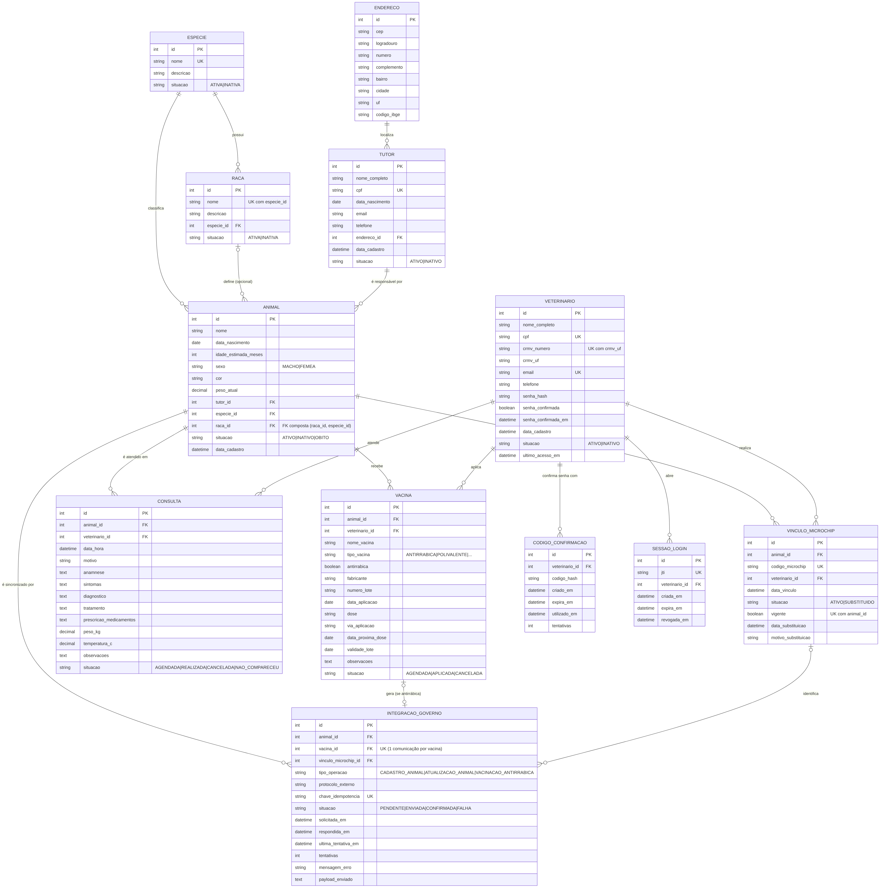
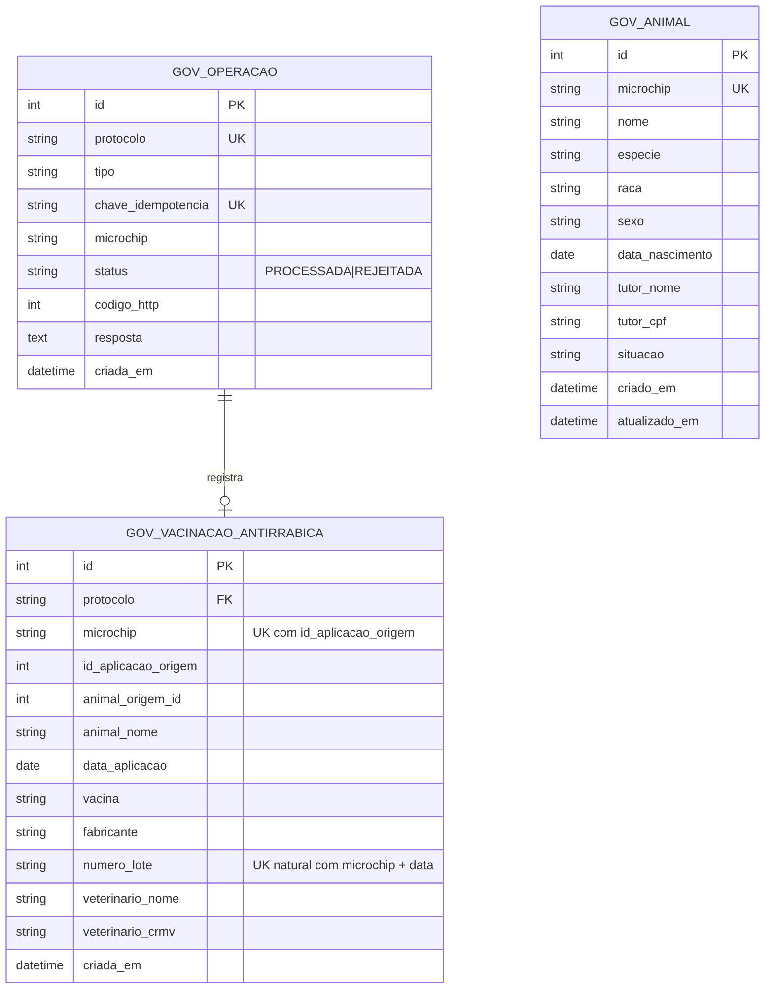

# 02 — Modelo de dados (ER e modelo relacional)

Projeto A3 – SDM · Sistema Web para Gestão de Clínica Veterinária com Integração de APIs

> **Entregável 2** do enunciado: modelo entidade-relacionamento e modelo relacional.
> Este arquivo é **gerado** por `scripts/gerar_doc_modelo.py` a partir do DDL real
> (`database/ddl.py`); as tabelas abaixo, portanto, correspondem exatamente ao banco criado
> por `database/mysql/*.sql`.

## 1. Visão geral

O sistema usa **dois bancos independentes**, porque a clínica e o governo são sistemas
distintos e só se comunicam por HTTP:

| Banco | Dono | Conteúdo |
|---|---|---|
| `sdm_clinica` | API privada da clínica | as 10 entidades obrigatórias do enunciado + 2 tabelas auxiliares de autenticação |
| `sdm_governo` | API governamental simulada | cadastro nacional de animais, registro de operações (idempotência) e vacinações antirrábicas |

### 1.1 Entidades obrigatórias (enunciado) e tabelas auxiliares

| # | Entidade do enunciado | Tabela | Observação |
|---|---|---|---|
| 1 | Espécie | `especie` | catálogo com situação ATIVA/INATIVA |
| 2 | Raça | `raca` | pertence a uma espécie; nome único dentro da espécie |
| 3 | Endereço | `endereco` | preenchido a partir do ViaCEP + número/complemento |
| 4 | Tutor | `tutor` | CPF único; um endereço |
| 5 | Veterinário | `veterinario` | CRMV (número+UF) único; senha com hash; confirmação de senha |
| 6 | Animal | `animal` | tutor, espécie e raça opcional (raça deve pertencer à espécie) |
| 7 | Microchip | `vinculo_microchip` | histórico de vínculos; **apenas um vigente** por animal |
| 8 | Consulta | `consulta` | anamnese, diagnóstico, tratamento, prescrição, sinais vitais |
| 9 | Vacina | `vacina` | aplicações/agendamentos; indicador `antirrabica` |
| 10 | Integração com o governo | `integracao_governo` | controle de comunicação: PENDENTE/ENVIADA/CONFIRMADA/FALHA |
| — | (auxiliar) | `codigo_confirmacao` | código de 6 dígitos guardado apenas como HMAC |
| — | (auxiliar) | `sessao_login` | sessões JWT revogáveis (logout/inativação) |

## 2. Diagrama entidade-relacionamento

### 2.1 Banco da clínica

Fonte editável: [`er-clinica.mmd`](er-clinica.mmd) (Mermaid).

Cardinalidades principais:

* **Espécie 1 — N Raça**; **Espécie 1 — N Animal**; **Raça 0..1 — N Animal** (a raça é opcional, p.ex. SRD).
* **Endereço 1 — N Tutor**; **Tutor 1 — N Animal**.
* **Animal 1 — N Vínculo de microchip** (histórico), com **no máximo 1 vigente**.
* **Animal 1 — N Consulta**, **Animal 1 — N Vacina**; ambos registram o **Veterinário** responsável.
* **Vacina 0..1 — 0..1 Integração** (somente vacinas antirrábicas geram integração de vacinação).
* **Animal 1 — N Integração** (cadastro/atualização do animal e vacinação).
* **Veterinário 1 — N Código de confirmação** e **1 — N Sessão de login**.

### 2.2 Banco do governo simulado

Fonte editável: [`er-governo.mmd`](er-governo.mmd).

O governo guarda **sua própria visão** do animal (chaveada pelo microchip, sem `id` da clínica
como chave) e registra cada operação recebida em `gov_operacao`, o que permite responder
a uma repetição da mesma `Idempotency-Key` com o **mesmo protocolo**, sem duplicar a vacinação.

## 3. Modelo relacional

Legenda: **PK** chave primária · **FK** chave estrangeira · **UK** parte de restrição de
unicidade · nomes `uq_*` (unicidade), `ck_*` (CHECK) e `fk_*` (chave estrangeira) são os
mesmos nomes de constraint existentes no script SQL.

### 3.1 Banco da clínica (`sdm_clinica`)

**especie**

| Coluna | Tipo | Nulo? | Chave | Observação |
|---|---|---|---|---|
| id | INT | não | PK |  |
| nome | VARCHAR(60) | não | UK |  |
| descricao | VARCHAR(255) | sim |  |  |
| situacao | VARCHAR(10) | não |  | default 'ATIVA' |

Unicidade: `uq_especie_nome` (nome)

Restrições CHECK: `ck_especie_situacao`

**raca**

| Coluna | Tipo | Nulo? | Chave | Observação |
|---|---|---|---|---|
| id | INT | não | PK, UK |  |
| nome | VARCHAR(80) | não | UK |  |
| descricao | VARCHAR(255) | sim |  |  |
| especie_id | INT | não | FK, UK | → especie.id |
| situacao | VARCHAR(10) | não |  | default 'ATIVA' |

Unicidade: `uq_raca_especie_nome` (especie_id, nome); `uq_raca_id_especie` (id, especie_id)

Restrições CHECK: `ck_raca_situacao`

**endereco**

| Coluna | Tipo | Nulo? | Chave | Observação |
|---|---|---|---|---|
| id | INT | não | PK |  |
| cep | CHAR(8) | não |  |  |
| logradouro | VARCHAR(150) | não |  |  |
| numero | VARCHAR(10) | não |  |  |
| complemento | VARCHAR(80) | sim |  |  |
| bairro | VARCHAR(80) | não |  |  |
| cidade | VARCHAR(80) | não |  |  |
| uf | CHAR(2) | não |  |  |
| codigo_ibge | CHAR(7) | sim |  |  |

Restrições CHECK: `ck_endereco_cep`

**tutor**

| Coluna | Tipo | Nulo? | Chave | Observação |
|---|---|---|---|---|
| id | INT | não | PK |  |
| nome_completo | VARCHAR(150) | não |  |  |
| cpf | CHAR(11) | não | UK |  |
| data_nascimento | DATE | não |  |  |
| email | VARCHAR(150) | não |  |  |
| telefone | VARCHAR(15) | não |  |  |
| endereco_id | INT | não | FK | → endereco.id |
| data_cadastro | DATETIME | não |  |  |
| situacao | VARCHAR(10) | não |  | default 'ATIVO' |

Unicidade: `uq_tutor_cpf` (cpf)

Restrições CHECK: `ck_tutor_situacao`, `ck_tutor_cpf`

**veterinario**

| Coluna | Tipo | Nulo? | Chave | Observação |
|---|---|---|---|---|
| id | INT | não | PK |  |
| nome_completo | VARCHAR(150) | não |  |  |
| cpf | CHAR(11) | não | UK |  |
| crmv_numero | VARCHAR(10) | não | UK |  |
| crmv_uf | CHAR(2) | não | UK |  |
| email | VARCHAR(150) | não | UK |  |
| telefone | VARCHAR(15) | não |  |  |
| senha_hash | VARCHAR(255) | não |  |  |
| senha_confirmada | TINYINT | não |  | default 0 |
| senha_confirmada_em | DATETIME | sim |  |  |
| data_cadastro | DATETIME | não |  |  |
| situacao | VARCHAR(10) | não |  | default 'ATIVO' |
| ultimo_acesso_em | DATETIME | sim |  |  |

Unicidade: `uq_veterinario_cpf` (cpf); `uq_veterinario_email` (email); `uq_veterinario_crmv` (crmv_numero, crmv_uf)

Restrições CHECK: `ck_veterinario_situacao`, `ck_veterinario_confirmacao`

**codigo_confirmacao**

| Coluna | Tipo | Nulo? | Chave | Observação |
|---|---|---|---|---|
| id | INT | não | PK |  |
| veterinario_id | INT | não | FK | → veterinario.id |
| codigo_hash | CHAR(64) | não |  |  |
| criado_em | DATETIME | não |  |  |
| expira_em | DATETIME | não |  |  |
| utilizado_em | DATETIME | sim |  |  |
| tentativas | INT | não |  | default 0 |

**sessao_login**

| Coluna | Tipo | Nulo? | Chave | Observação |
|---|---|---|---|---|
| id | INT | não | PK |  |
| jti | CHAR(32) | não | UK |  |
| veterinario_id | INT | não | FK | → veterinario.id |
| criada_em | DATETIME | não |  |  |
| expira_em | DATETIME | não |  |  |
| revogada_em | DATETIME | sim |  |  |

Unicidade: `uq_sessao_jti` (jti)

**animal**

| Coluna | Tipo | Nulo? | Chave | Observação |
|---|---|---|---|---|
| id | INT | não | PK |  |
| nome | VARCHAR(80) | não |  |  |
| data_nascimento | DATE | sim |  |  |
| idade_estimada_meses | INT | sim |  |  |
| sexo | VARCHAR(10) | não |  |  |
| cor | VARCHAR(50) | não |  |  |
| peso_atual | DECIMAL(6,2) | não |  |  |
| tutor_id | INT | não | FK | → tutor.id |
| especie_id | INT | não | FK | → raca.especie_id, especie.id |
| raca_id | INT | sim | FK | → raca.id |
| situacao | VARCHAR(10) | não |  | default 'ATIVO' |
| data_cadastro | DATETIME | não |  |  |

Restrições CHECK: `ck_animal_sexo`, `ck_animal_situacao`, `ck_animal_idade`, `ck_animal_peso`

**vinculo_microchip**

| Coluna | Tipo | Nulo? | Chave | Observação |
|---|---|---|---|---|
| id | INT | não | PK |  |
| animal_id | INT | não | FK, UK | → animal.id |
| codigo_microchip | VARCHAR(15) | não | UK |  |
| veterinario_id | INT | não | FK | → veterinario.id |
| data_vinculo | DATETIME | não |  |  |
| situacao | VARCHAR(12) | não |  | default 'ATIVO' |
| vigente | TINYINT | sim | UK |  |
| data_substituicao | DATETIME | sim |  |  |
| motivo_substituicao | VARCHAR(255) | sim |  |  |

Unicidade: `uq_microchip_codigo` (codigo_microchip); `uq_microchip_animal_vigente` (animal_id, vigente)

Restrições CHECK: `ck_vinculo_codigo`, `ck_vinculo_situacao`

**consulta**

| Coluna | Tipo | Nulo? | Chave | Observação |
|---|---|---|---|---|
| id | INT | não | PK |  |
| animal_id | INT | não | FK | → animal.id |
| veterinario_id | INT | não | FK | → veterinario.id |
| data_hora | DATETIME | não |  |  |
| motivo | VARCHAR(255) | não |  |  |
| anamnese | TEXT | sim |  |  |
| sintomas | TEXT | sim |  |  |
| diagnostico | TEXT | sim |  |  |
| tratamento | TEXT | sim |  |  |
| prescricao_medicamentos | TEXT | sim |  |  |
| peso_kg | DECIMAL(6,2) | sim |  |  |
| temperatura_c | DECIMAL(4,1) | sim |  |  |
| observacoes | TEXT | sim |  |  |
| situacao | VARCHAR(15) | não |  | default 'AGENDADA' |

Restrições CHECK: `ck_consulta_situacao`, `ck_consulta_peso`, `ck_consulta_temp`

**vacina**

| Coluna | Tipo | Nulo? | Chave | Observação |
|---|---|---|---|---|
| id | INT | não | PK |  |
| animal_id | INT | não | FK | → animal.id |
| veterinario_id | INT | não | FK | → veterinario.id |
| nome_vacina | VARCHAR(100) | não |  |  |
| tipo_vacina | VARCHAR(30) | não |  |  |
| antirrabica | TINYINT | não |  | default 0 |
| fabricante | VARCHAR(100) | sim |  |  |
| numero_lote | VARCHAR(50) | sim |  |  |
| data_aplicacao | DATE | não |  |  |
| dose | VARCHAR(40) | não |  |  |
| via_aplicacao | VARCHAR(20) | não |  |  |
| data_proxima_dose | DATE | sim |  |  |
| validade_lote | DATE | sim |  |  |
| observacoes | TEXT | sim |  |  |
| situacao | VARCHAR(10) | não |  | default 'APLICADA' |

Restrições CHECK: `ck_vacina_tipo`, `ck_vacina_via`, `ck_vacina_situacao`, `ck_vacina_antirrabica`, `ck_vacina_proxima`, `ck_vacina_aplicada_completa`

**integracao_governo**

| Coluna | Tipo | Nulo? | Chave | Observação |
|---|---|---|---|---|
| id | INT | não | PK |  |
| animal_id | INT | não | FK | → animal.id |
| vacina_id | INT | sim | FK, UK | → vacina.id |
| vinculo_microchip_id | INT | sim | FK | → vinculo_microchip.id |
| tipo_operacao | VARCHAR(30) | não |  |  |
| protocolo_externo | VARCHAR(40) | sim |  |  |
| chave_idempotencia | VARCHAR(100) | não | UK |  |
| situacao | VARCHAR(12) | não |  | default 'PENDENTE' |
| solicitada_em | DATETIME | não |  |  |
| respondida_em | DATETIME | sim |  |  |
| ultima_tentativa_em | DATETIME | sim |  |  |
| tentativas | INT | não |  | default 0 |
| mensagem_erro | VARCHAR(500) | sim |  |  |
| payload_enviado | TEXT | sim |  |  |

Unicidade: `uq_integracao_chave` (chave_idempotencia); `uq_integracao_vacina` (vacina_id)

Restrições CHECK: `ck_integracao_tipo`, `ck_integracao_situacao`, `ck_integracao_vacina`, `ck_integracao_tentativas`

### 3.2 Banco do governo simulado (`sdm_governo`)

**gov_animal**

| Coluna | Tipo | Nulo? | Chave | Observação |
|---|---|---|---|---|
| id | INT | não | PK |  |
| microchip | VARCHAR(15) | não | UK |  |
| nome | VARCHAR(80) | não |  |  |
| especie | VARCHAR(60) | não |  |  |
| raca | VARCHAR(80) | sim |  |  |
| sexo | VARCHAR(10) | não |  |  |
| data_nascimento | DATE | sim |  |  |
| tutor_nome | VARCHAR(150) | não |  |  |
| tutor_cpf | CHAR(11) | não |  |  |
| situacao | VARCHAR(10) | não |  | default 'ATIVO' |
| criado_em | DATETIME | não |  |  |
| atualizado_em | DATETIME | não |  |  |

Unicidade: `uq_gov_animal_microchip` (microchip)

Restrições CHECK: `ck_gov_animal_sexo`, `ck_gov_animal_situacao`

**gov_operacao**

| Coluna | Tipo | Nulo? | Chave | Observação |
|---|---|---|---|---|
| id | INT | não | PK |  |
| protocolo | VARCHAR(30) | não | UK |  |
| tipo | VARCHAR(30) | não |  |  |
| chave_idempotencia | VARCHAR(100) | sim | UK |  |
| microchip | VARCHAR(15) | sim |  |  |
| status | VARCHAR(12) | não |  |  |
| codigo_http | INT | não |  |  |
| resposta | TEXT | não |  |  |
| criada_em | DATETIME | não |  |  |

Unicidade: `uq_gov_operacao_protocolo` (protocolo); `uq_gov_operacao_chave` (chave_idempotencia)

Restrições CHECK: `ck_gov_operacao_tipo`, `ck_gov_operacao_status`

**gov_vacinacao_antirrabica**

| Coluna | Tipo | Nulo? | Chave | Observação |
|---|---|---|---|---|
| id | INT | não | PK |  |
| protocolo | VARCHAR(30) | não | FK | → gov_operacao.protocolo |
| microchip | VARCHAR(15) | não | UK |  |
| id_aplicacao_origem | INT | não | UK |  |
| animal_origem_id | INT | não |  |  |
| animal_nome | VARCHAR(80) | não |  |  |
| data_aplicacao | DATE | não | UK |  |
| vacina | VARCHAR(100) | não |  |  |
| fabricante | VARCHAR(100) | não |  |  |
| numero_lote | VARCHAR(50) | não | UK |  |
| veterinario_nome | VARCHAR(150) | não |  |  |
| veterinario_crmv | VARCHAR(20) | não |  |  |
| criada_em | DATETIME | não |  |  |

Unicidade: `uq_gov_vac_origem` (microchip, id_aplicacao_origem); `uq_gov_vac_natural` (microchip, data_aplicacao, numero_lote)

## 4. Decisões de modelagem

**4.1 Raça compatível com a espécie (FK composta).**
`raca` possui `UNIQUE (id, especie_id)` e `animal` referencia `(raca_id, especie_id)`.
Assim o *próprio banco* impede cadastrar, por exemplo, um "Siamês" para um cão. Como a raça é
opcional (`raca_id NULL`), o MySQL não valida a FK composta quando `raca_id` é nulo (comportamento
`MATCH SIMPLE`), e o animal sem raça definida (SRD) continua permitido.

**4.2 Apenas um microchip vigente por animal (coluna `vigente`).**
Um índice `UNIQUE (animal_id)` impediria guardar o histórico. A solução usada é
`UNIQUE (animal_id, vigente)` com `vigente = 1` para o vínculo ativo e `vigente = NULL` para os
substituídos: unicidade em colunas com `NULL` não é violada (vários `NULL` são permitidos), então
existe no máximo **um** registro ativo por animal, mas qualquer quantidade de históricos.
O `CHECK ck_vinculo_situacao` mantém `situacao` e `vigente` coerentes. O código do chip também
é único globalmente (`uq_microchip_codigo`): um mesmo chip não pode estar em dois animais.

**4.3 Domínios por CHECK, não ENUM.**
Situações e tipos usam `CHECK (... IN (...))`, o que mantém o DDL idêntico em MySQL e SQLite e
facilita a evolução (basta alterar a constraint). Exige **MySQL ≥ 8.0.16** — versões anteriores
aceitam a sintaxe mas *ignoram* o CHECK.

**4.4 Exclusão lógica.**
Nenhuma tabela usa `ON DELETE CASCADE`. Registros clínicos nunca são apagados: tutores,
animais, veterinários e catálogos mudam de `situacao` (ATIVO/INATIVO etc.), e consultas/vacinas
são *canceladas*. Isso preserva o histórico e a rastreabilidade exigida em dados de saúde animal.

**4.5 Vacina antirrábica identificada por coluna e consistente com o tipo.**
`vacina.antirrabica` (0/1) existe para consulta rápida, e o `CHECK ck_vacina_antirrabica` garante que
seja 1 *se e somente se* `tipo_vacina = 'ANTIRRABICA'`. Uma vacina com `situacao = 'APLICADA'` exige
fabricante, lote e validade do lote (`ck_vacina_aplicada_completa`); a próxima dose, quando
informada, é posterior à aplicação (`ck_vacina_proxima`).

**4.6 Controle de integração como *outbox*.**
`integracao_governo` é gravada **na mesma transação** da vacina/vínculo que a originou, já como
`PENDENTE`; só depois a API tenta chamar o governo. Se o governo estiver fora do ar, o registro local
permanece e a pendência fica visível e reenviável. Garantias de integridade:

* `uq_integracao_vacina (vacina_id)` — uma vacina gera **no máximo uma** integração;
* `uq_integracao_chave (chave_idempotencia)` — a chave enviada no cabeçalho `Idempotency-Key`
  é única, o que permite reenviar sem duplicar do lado do governo;
* `ck_integracao_vacina` — `vacina_id` é obrigatório para `VACINACAO_ANTIRRABICA` e proibido
  para os demais tipos;
* `ck_integracao_situacao` — estados válidos: `PENDENTE`, `ENVIADA`, `CONFIRMADA`, `FALHA`;
* `payload_enviado` guarda o JSON exatamente como foi enviado (auditoria / reenvio idêntico).

**4.7 Segurança dos dados de autenticação.**
`veterinario.senha_hash` guarda apenas o hash *scrypt* (Werkzeug) — nunca a senha.
`codigo_confirmacao.codigo_hash` guarda um HMAC-SHA256 do código de 6 dígitos (64 caracteres hex),
com validade (`expira_em`), uso único (`utilizado_em`) e contador de tentativas.
`ck_veterinario_confirmacao` garante que `senha_confirmada = 1` ocorra somente com a data
de confirmação preenchida. `sessao_login.jti` permite **revogar** tokens (logout, inativação do
veterinário) mesmo antes da expiração.

**4.8 Endereço separado do tutor.**
O endereço (CEP, logradouro, bairro, cidade, UF, código IBGE) vem do ViaCEP; `numero` e
`complemento` são informados pelo usuário. Fica em tabela própria (1 endereço → N tutores)
conforme a lista de entidades do enunciado.

**4.9 Tipos e formatos.**
CPF e CEP são `CHAR` só com dígitos (a máscara é apenas de apresentação); o microchip é
`VARCHAR(15)` com `CHECK` de 15 caracteres (padrão ISO 11784/11785); peso com `DECIMAL(6,2)`
e temperatura com `DECIMAL(4,1)` (faixa 30–45 °C). Datas/horas são gravadas pela aplicação
(sem `DEFAULT` dependente de função) no horário local do servidor, sem fuso.

**4.10 Índices.**
Além dos índices implícitos de PK/UK/FK: `idx_animal_tutor`, `idx_consulta_animal_data`,
`idx_vacina_animal_data` (históricos por animal), `idx_integracao_situacao` (fila de pendentes) e
`idx_integracao_animal`.

**4.11 Banco do governo.**
`gov_animal` é chaveado por `microchip` (único). `gov_operacao` registra *toda* operação recebida —
inclusive as rejeitadas — com `chave_idempotencia` única, o código HTTP e a resposta original, para
repetir exatamente a mesma resposta num reenvio. `gov_vacinacao_antirrabica` tem duas unicidades:
`(microchip, id_aplicacao_origem)` (a mesma aplicação da clínica nunca é registrada duas vezes) e
`(microchip, data_aplicacao, numero_lote)` (a mesma dose física não vira dois registros mesmo com
chaves de idempotência diferentes).

## 5. Como o modelo foi validado

* O DDL é executado na criação do banco em **todos** os testes automatizados
  (`tests/test_modelo_dados.py`), que exercitam cada `CHECK`, `UNIQUE` e `FOREIGN KEY` relevante:
  raça de outra espécie, segundo microchip vigente, vacina aplicada sem lote, integração duplicada etc.
* O script MySQL (`database/mysql/01_clinica_schema.sql`, `03_governo_schema.sql`) é **gerado** do mesmo
  DDL por `scripts/gerar_sql.py`. Neste ambiente de desenvolvimento não havia servidor MySQL, então os
  testes automatizados rodam em SQLite com o mesmo DDL; a execução em MySQL deve ser conferida
  seguindo o README (seção "Banco MySQL") — ver limitações no relatório de testes.
